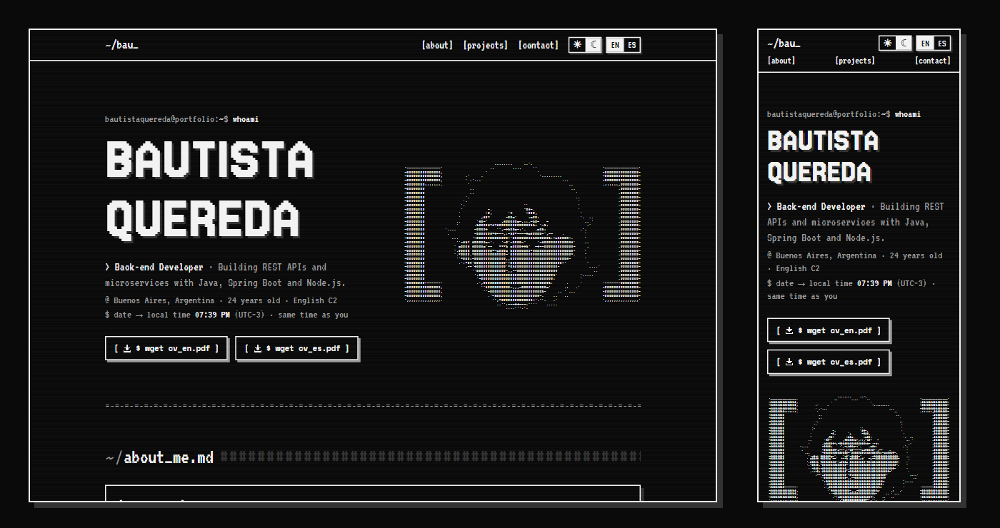

<a href="https://bautistaquereda.dev">
  
</a>

<p>
  <a href="https://bautistaquereda.dev"></a>&nbsp;
  <a href="https://bautistaquereda.dev/cv/Bautista-Quereda-BackendDev-CV-ENG.pdf"></a>&nbsp;
  <a href="https://bautistaquereda.dev/cv/Bautista-Quereda-BackendDev-CV-ESP.pdf"></a>
</p>

<picture>
  <source media="(prefers-color-scheme: light)" srcset=".github/readme/preview-light.png">
  
</picture>

## ~/features

| feature | what it does |
|---|---|
| **Retro terminal UI** | Black & white CRT look: pixel fonts (Jersey 15, VT323, Space Mono), scanlines, `[ bracket ]` labels and shell-style section titles. |
| **Day / night mode** | Follows the system theme by default, remembers the visitor's choice and applies it before the first paint (no flash). |
| **EN / ES** | Every text lives in `i18n.js`. The Spanish version has its own URL (`/es/`) with `hreflang` tags, generated with `node tools/build-es.js` (run it after editing `index.html` or `i18n.js`). |
| **Animated ASCII portrait** | Redraws itself on load and blinks every few seconds. Respects `prefers-reduced-motion`. |
| **Live local clock** | Shows my time in Buenos Aires (UTC−3) and how many hours apart the visitor is. |
| **Data-driven content** | Projects and tech stack are rendered from a single file (`projects.js`), with Devicon icons. |
| **SEO & link previews** | Meta and Open Graph tags, a 1200×630 preview image, `Person` structured data (JSON-LD), `sitemap.xml` and `robots.txt`. |
| **Security headers** | `_headers` sets HSTS, `X-Frame-Options`, `nosniff`, `Referrer-Policy` and `Permissions-Policy` on Cloudflare Pages. |
| **Custom 404** | A stack-trace style error page that keeps the site's theme. |
| **Easter egg** | `↑ ↑ ↓ ↓ ← → ← → B A` (or `$ ./snake.sh` in the footer) opens an ASCII snake game that saves your best score. |

## ~/stack


No frameworks, no bundler, no dependencies: the repo is the site.

## ~/structure

```text
.
├── index.html            page markup, meta tags and JSON-LD
├── styles.css            theme (night / day), layout and CRT effects
├── script.js             theme + language toggles, clock, stack and project cards
├── i18n.js               every text in English and Spanish
├── projects.js           projects and tech stack (edit here to update the site)
├── avatar.js             ASCII portrait animation
├── avatar-ascii*.txt     portrait for night / day mode
├── snake.js              easter egg
├── 404.html              custom error page
├── cv/                   downloadable CVs (EN / ES)
├── _headers              Cloudflare Pages security and cache headers
└── sitemap.xml, robots.txt, og-image.png, favicons
```

## ~/run

It's a static site, so any local server works:

```bash
python -m http.server 8000
```

Then open <http://localhost:8000>.

## ~/deploy

Hosted on **Cloudflare Pages** as a plain static site: no build command, the output directory is the repo root.
Security and cache headers come from `_headers`.

---

<sub>(c) 2026 Bautista Quereda :: built with HTML, CSS & JavaScript :: EOF</sub>
